# **SOTIF-Oriented Unknown Object Detection for Open-World Autonomous Driving**

This repository provides the official code implementation of the paper **"SOTIF-Oriented Unknown Object Detection for Open-World Autonomous Driving."**

Built upon **Deformable DETR**, this work develops an open-world object detection framework to improve the discovery and detection of unknown obstacles that are unseen during training in open-road autonomous driving environments. Furthermore, it quantifies the perception risks associated with unknown objects from the perspective of **Safety of the Intended Functionality (SOTIF)**.

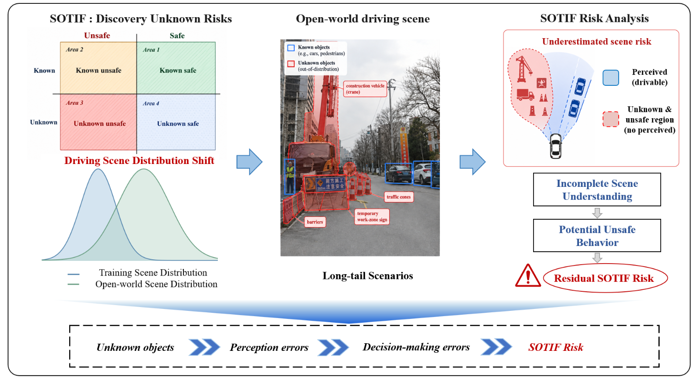

## **Abstract**

In open and dynamic road environments, autonomous driving systems encounter long-tail obstacles absent from training datasets. Due to the limitations of closed-set perception models, unknown objects may be misclassified as background even without hardware or software failures, resulting in unknown unsafe scenarios related to Safety of the Intended Functionality (SOTIF). To address the trade-off between unknown-object recall and prediction precision in existing open-world object detection methods, this paper proposes a class-unbiased and decoupled open-world object detection framework. First, an independent objectness head is introduced. Its supervision combines class-agnostic geometric overlap with aggregated known-class confidence scores to reduce category bias in the two-stage query generation process. Second, feature decoupling is applied to the Deformable Transformer decoder. Self-attention is shared to preserve query interactions, while cross-attention and feed-forward networks are independently implemented in the classification and localization-objectness branches. This design alleviates optimization conflicts among semantic recognition, box regression, and objectness learning. Finally, a conditional probability-based inference mechanism is introduced to jointly estimate known and unknown object scores, assigning unknown probabilities to detected objects that do not belong to any known category. Experiments on the M-OWODB dataset demonstrate that the proposed method achieves 23.9% U-Recall and 9.6% U-AP, outperforming ENC-DETR by 3.7 and 0.4 percentage points, respectively, while maintaining a known-class K-AP of 58.3%. Cross-dataset experiments, using BDD100K for training and CODA for testing, further demonstrate its ability to detect unknown obstacles in real-world autonomous driving corner cases. The proposed method offers a perception-level approach to mitigating SOTIF-related unknown unsafe scenarios.

## 📌 **Project Overview**

Traditional object detection models are typically built upon the closed-set assumption, under which all object categories encountered during testing are predefined during training.

However, in real-world open-road environments, autonomous driving systems inevitably encounter long-tail objects, anomalous obstacles, and corner-case scenarios that are not covered by training data. When unknown objects are mistakenly classified as background, potential safety risks may arise from insufficient perception capabilities, even in the absence of hardware or software failures.

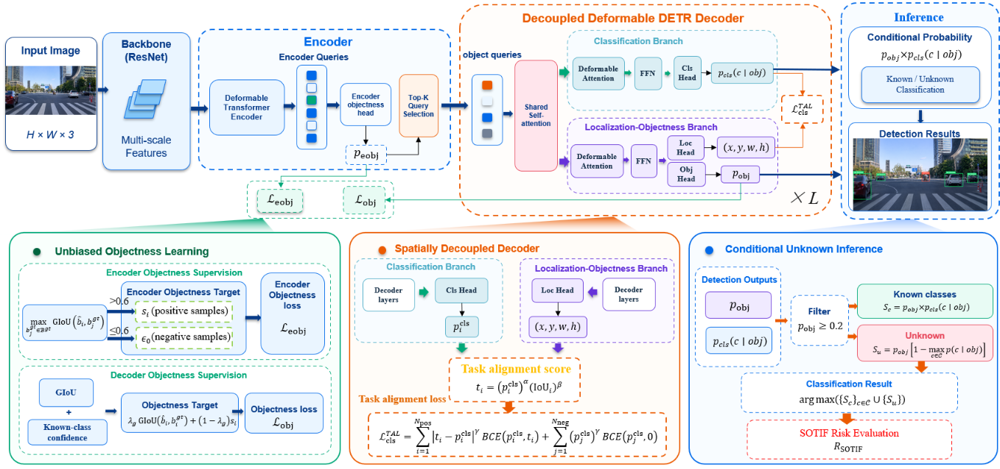

To address the aforementioned challenges, this project proposes a **class-unbiased and spatially decoupled open-world object detection framework**, consisting of the following three key components:

- **Class-unbiased geometric objectness perception mechanism.** An independent objectness prediction branch is designed to enable the model to first determine whether a candidate region contains a genuine object. By combining GIoU-based geometric information with aggregated known-class confidence, a dedicated objectness supervision signal is constructed. This reduces the model's dependence on known-category semantics, facilitates class-unbiased unknown object perception, and improves unknown object recall.

- **Multi-task spatial feature decoupling architecture.** The spatial decoupling mechanism is extended to a two-stage Deformable DETR framework, explicitly decoupling the attention representations of the classification branch and the localization–objectness branch. This design effectively alleviates potential task conflicts caused by highly coupled feature representations and yields improved detection performance.

- **Conditional probability-based unknown inference and SOTIF risk assessment.** A conditional probability-based unknown inference mechanism is proposed to identify unknown objects by jointly considering object existence probabilities and known-class conditional probabilities during inference. Furthermore, a perception-level SOTIF risk metric is developed to evaluate the model's ability to discover unknown objects, and the relationships between U-Recall, U-AP, and perception risk are analyzed.

## ✨Data Structure

```
SOTIF-OWOD/
└── data/
    └── CODA/
        ├── train (train and val set of SODA)
        ├── val (val set of CODA)
        └── annotations
            ├── train.json
            ├── val.json
            └── annotation.json (CODA)
    └── BDD/
        ├── train
        ├── val
        └── annotations
            ├── bdd100k_labels_images_det_coco_train.json
            ├── bdd100k_labels_images_det_coco_val.json
            └── annotation.json (CODA)
```

### Dataset Preparation

CODA:

- Download the train and val set of SODA from https://soda-2d.github.io/download.html.
- Download the val set of CODA from https://coda-dataset.github.io/.
- Prepare the annotation files. (1) Get the train.json file by running . (2) Get the val.json by running and . You can also directly download the annotation files from [here](https://drive.google.com/file/d/1YskzEbtRqrjYzic5roWPEGqtDH7cXFJS)`eval_tools/merge_json.py``eval_tools/coda_format_to_voc.py``eval_tools/convert_coda_to_coco.py`

BDD:

- Download the train and val set of BDD0100K from https://doc.bdd100k.com/download.html.

**References for M-OWODB Dataset Preparation**[orrzohar/PROB: [CVPR 2023\] Official Pytorch code for PROB: Probabilistic Objectness for Open World Object Detection](https://github.com/orrzohar/PROB)

## ⚙️Installation

### Requirements

- Linux， CUDA>=9.2， GCC>=5.4

- Python>=3.7

  We recommend you to use Anaconda to create a conda environment:

  ```
  conda create -n deformable_detr python=3.7 pip
  ```

  Then, activate the environment:

  ```
  conda activate deformable_detr
  ```

- PyTorch>=1.5.1, torchvision>=0.6.1 (following instructions [here]

  For example, if your CUDA version is 9.2, you could install pytorch and torchvision as following:

  ```
  conda install pytorch=1.5.1 torchvision=0.6.1 cudatoolkit=9.2 -c pytorch
  ```

- Other requirements

  ```
  pip install -r requirements.txt
  ```

### Compiling CUDA operators

```bash
cd ./models/ops
sh ./make.sh
# unit test (should see all checking is True)
python test.py
```

## 🚀Train

```bash
bash ./configs/r50_deformable_detr_bdd_coda.sh
```

## 📈Evaluation

```bash
bash ./eval/eval_bdd_coda.sh
```

## 📊 **Experimental Results**

### M-OWODB

This work follows the **M-OWODB Task 1** setting:

```
Known classes:
20 VOC classes

Unknown classes:
60 COCO classes
```

During training, supervision is provided only for the 20 known classes. At test time, the remaining 60 classes are treated as unknown.

### Main Result

| Model    | U-Recall ↑ | U-AP ↑  |  K-AP ↑  |
| -------- | ---------- | ------- | :------: |
| ORE      | 5.7        | 0.7     |   56.0   |
| OW-DETR  | 7.5        | 0.1     |   59.2   |
| ALLOW    | 13.6       | 4.9     |   59.3   |
| CAT      | 23.7       | -       |   60.0   |
| PROB     | 19.4       | 1.2     |   59.5   |
| TARO     | 20.9       | -       |   57.9   |
| ENC-DETR | 20.2       | 9.2     | **61.0** |
| **Ours** | **23.9**   | **9.6** |   58.3   |

### 🧪 Ablation Study

This work conducts a progressive ablation study on the three core components:

- **CUO**：Class-Unbiased Objectness Learning
- **SD**：Spatially Decoupled Multi-Task Representation
- **CUI**：Conditioned Unknown Inference

| CUO  | SD   | CUI  | U-Recall ↑ | U-AP ↑  | K-AP ↑   |
| ---- | ---- | ---- | ---------- | ------- | -------- |
| ✓    |      |      | 16.8       | 9.2     | 52.5     |
| ✓    | ✓    |      | **24.9**   | 9.2     | 53.6     |
| ✓    | ✓    | ✓    | 23.9       | **9.6** | **58.3** |

### 🛡️ **SOTIF Risk Evaluation Experiments**

#### M-OWODB

| Model    | (R_SOTIF@10) ↓ | (R_SOTIF@20) ↓ | (R_SOTIF@30) ↓ |
| -------- | -------------- | -------------- | -------------- |
| PROB     | 0.8469         | 0.8268         | 0.8182         |
| **Ours** | **0.8212**     | **0.8173**     | **0.8112**     |

Compared with PROB, the proposed method achieves lower SOTIF perception risk across different values of K. The results suggest that, with comparable unknown object recall, our method reduces the interference of low-quality unknown predictions with the ranking of ground-truth unknown objects.

### 🚗 BDD100K → CODA Cross-Dataset Evaluation

To evaluate the generalization capability of the proposed model in real-world open-road autonomous driving environments, we conduct cross-dataset experiments using the following protocol:

```
BDD100K
   ↓
Training on known traffic object categories
   ↓
CODA
   ↓
Evaluating unknown corner-case objects
```

The known categories are defined as follows:

```
BDD100K:
person
rider
car
bus
truck

CODA:
pedestrian
cyclist
car
bus
truck
```

The remaining CODA corner-case categories are treated as unknown classes.

#### Experimental Results

| Model    | U-R@10 ↑ | U-R@20 ↑ | U-R@30 ↑ | U-Recall ↑ | U-AP ↑   | K-AP ↑   |
| -------- | -------- | -------- | -------- | ---------- | -------- | -------- |
| **Ours** | **23.0** | **24.4** | **25.1** | **30.5**   | **12.8** | **52.7** |

The results demonstrate that the proposed method retains its ability to generalize to unknown objects under cross-dataset distribution shifts.

#### **Qualitative Results**

The figure presents qualitative detection results and corresponding attention visualizations of the proposed framework. 

**Attention Visualization.**The attention maps further reveal the spatial response patterns of the decoder, highlighting regions of interest associated with object localization and feature representation. The red ellipses indicate representative regions of interest, providing insights into the model's attention distribution and spatial perception behavior.

<p align="center">
  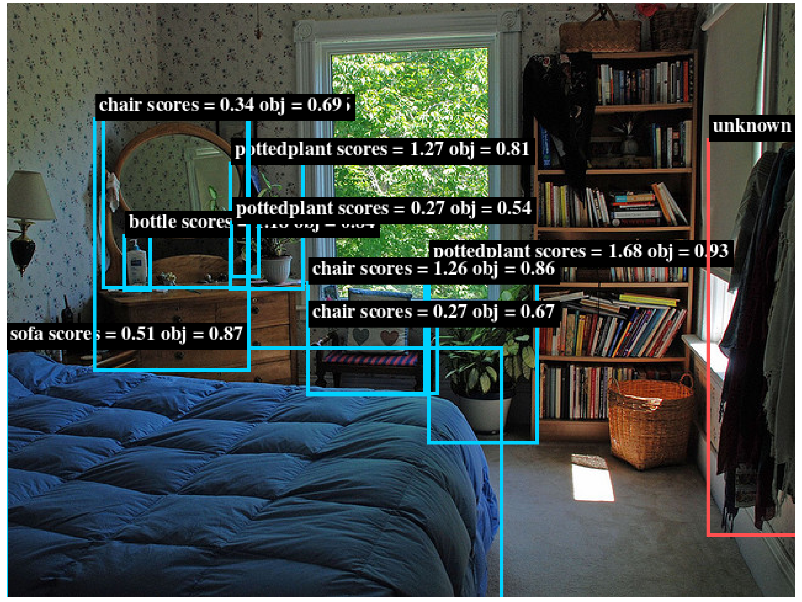
  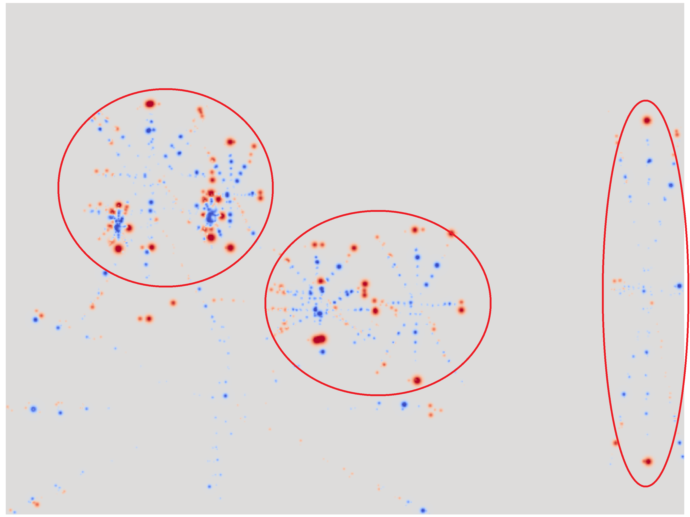
</p>

<p align="center">
  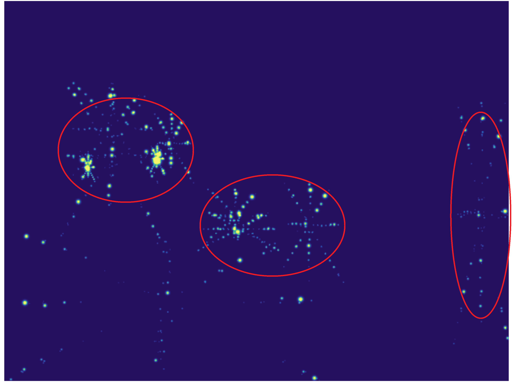
  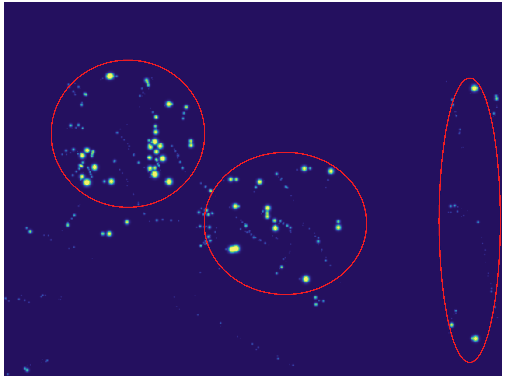
</p>
**Attention Distribution Analysis.** The attention distribution across decoder layers reveals distinct spatial response patterns between the decoupled classification and localization branches. The classification branch maintains a consistently high attention ratio within predicted bounding boxes, while the localization branch exhibits a more distributed attention pattern.

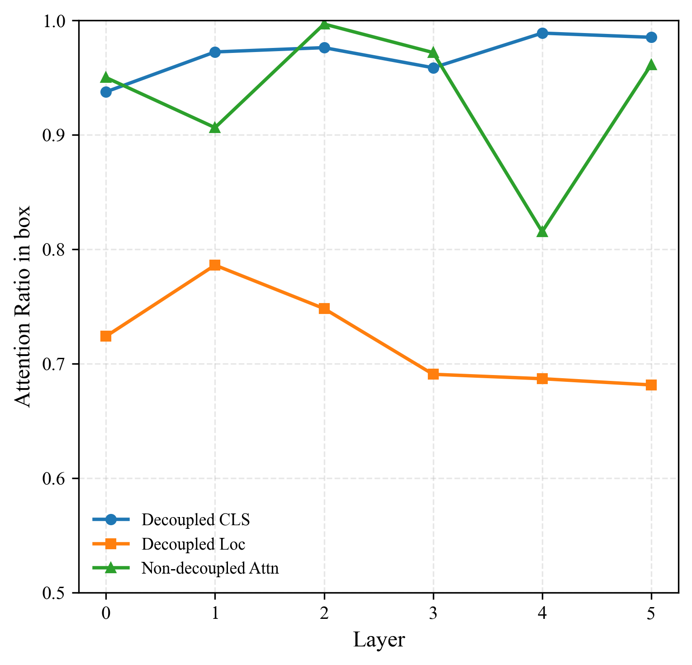

**PCA Feature Distribution Visualization.** PCA is applied to project the feature representations of background, known, and unknown objects into a two-dimensional space. The visualization reveals partial overlap between known and unknown object representations, highlighting the challenge of unknown object discovery and discrimination in open-world environments.

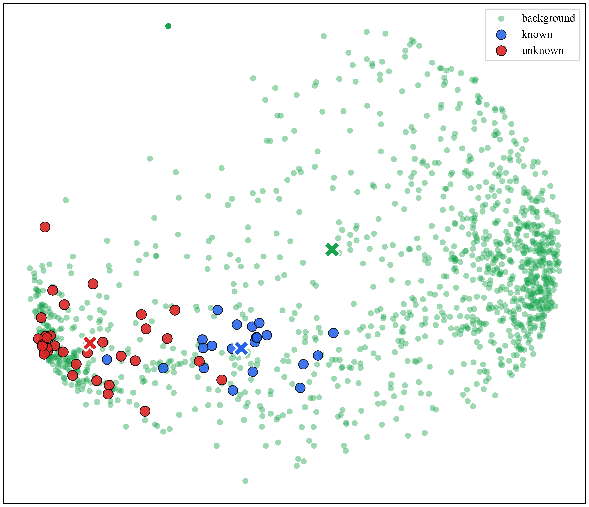

**Cross-Dataset Detection Visualization.** The figure presents qualitative detection results on CODA, comparing the original images, ground-truth annotations, and model predictions. The results demonstrate the model's ability to detect known objects and identify unknown obstacles in diverse real-world autonomous driving scenarios, including complex urban traffic and nighttime environments.

|                 Original picture                 |                        Ground Truth                         |                  Prediction                  |
| :----------------------------------------------: | :---------------------------------------------------------: | :------------------------------------------: |
| 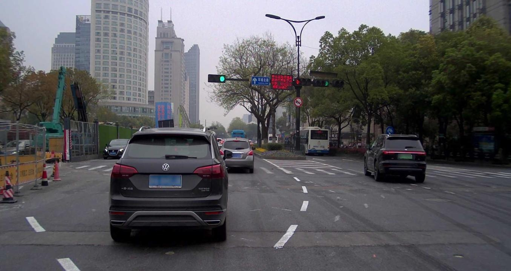 | 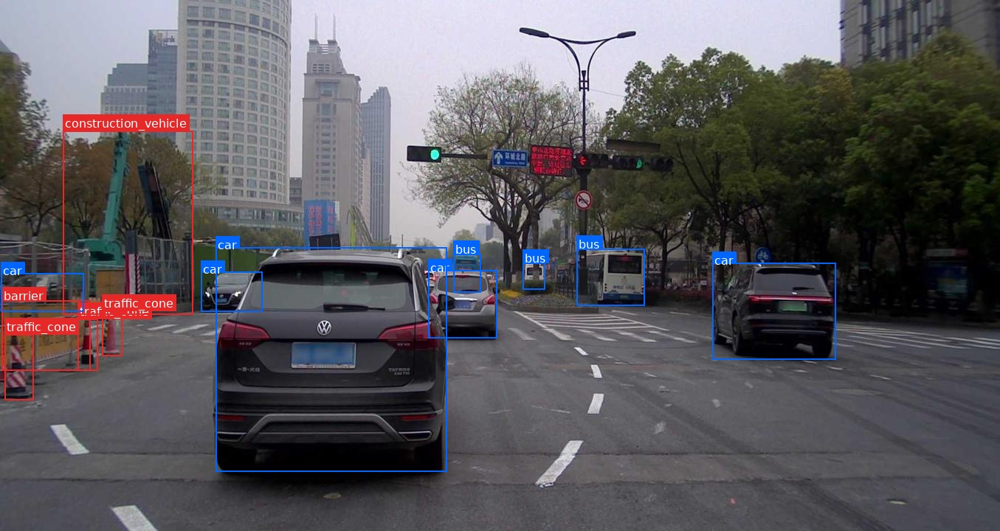 | 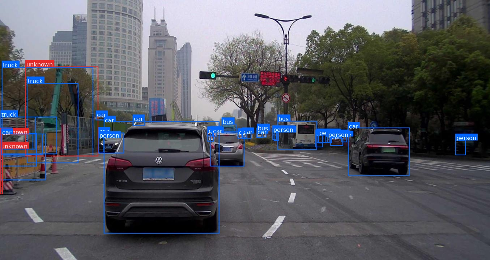 |
| 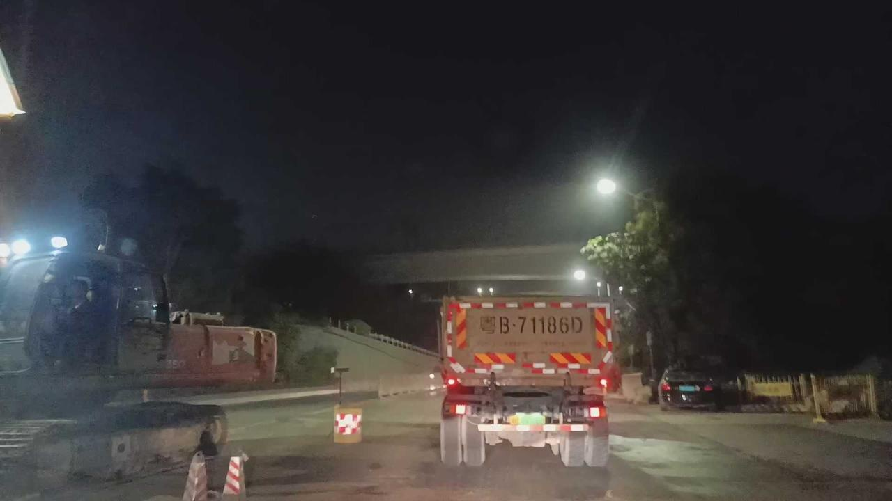 |         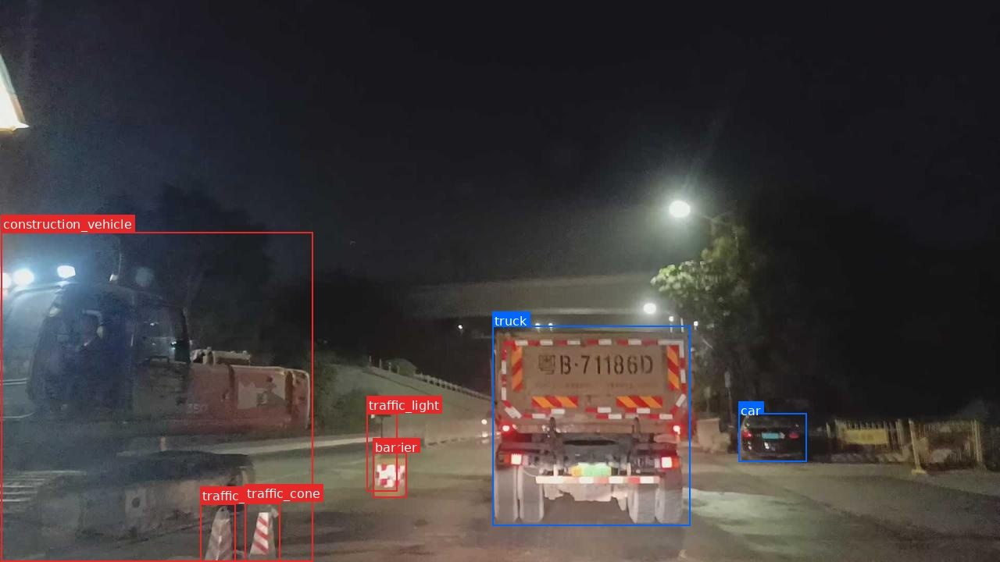          | 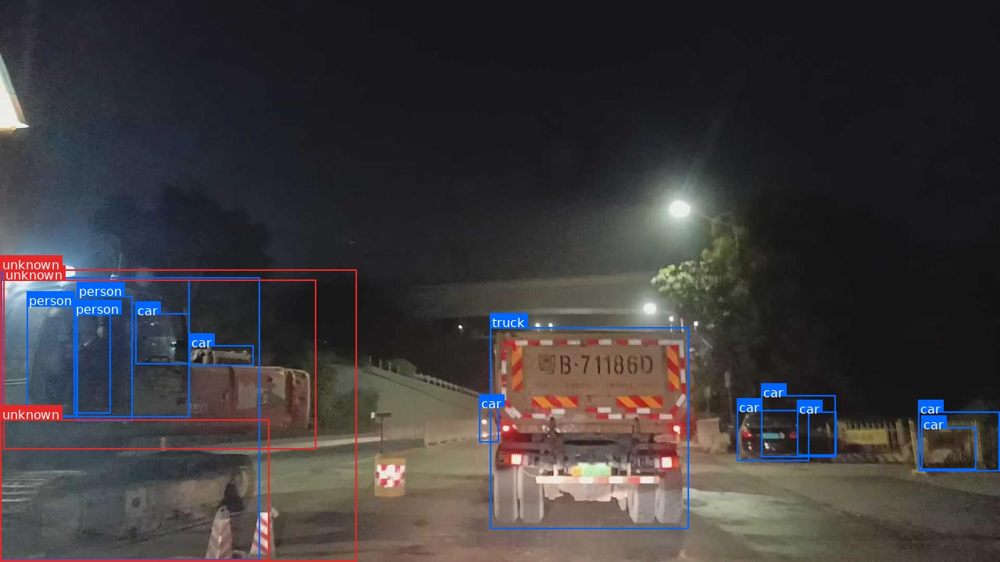 |


